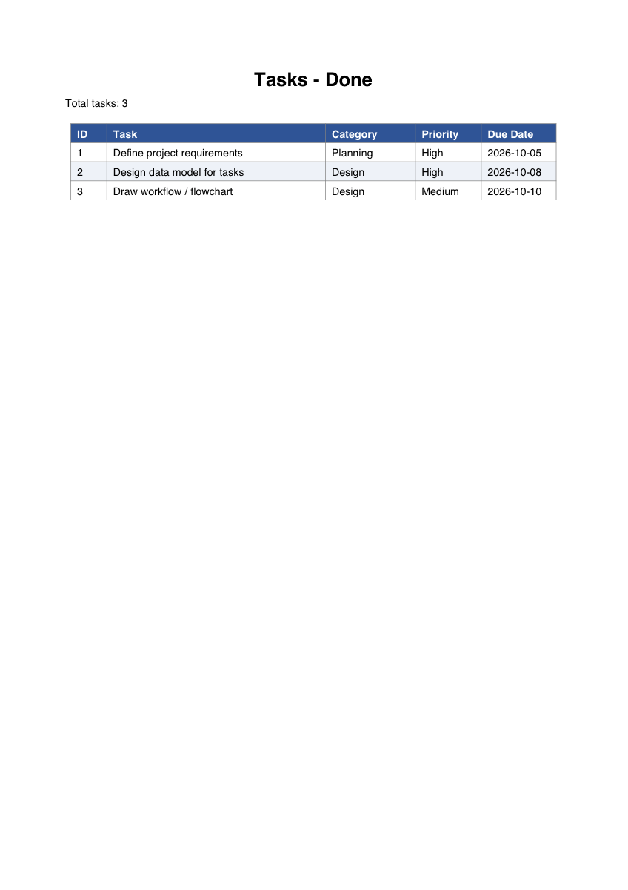
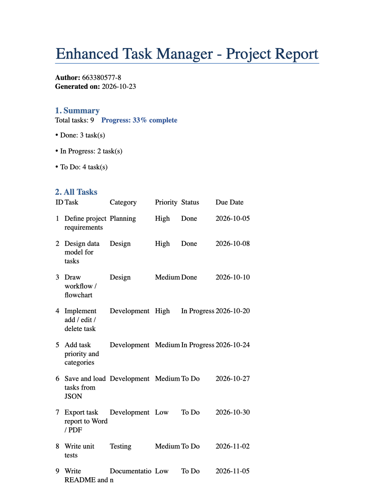
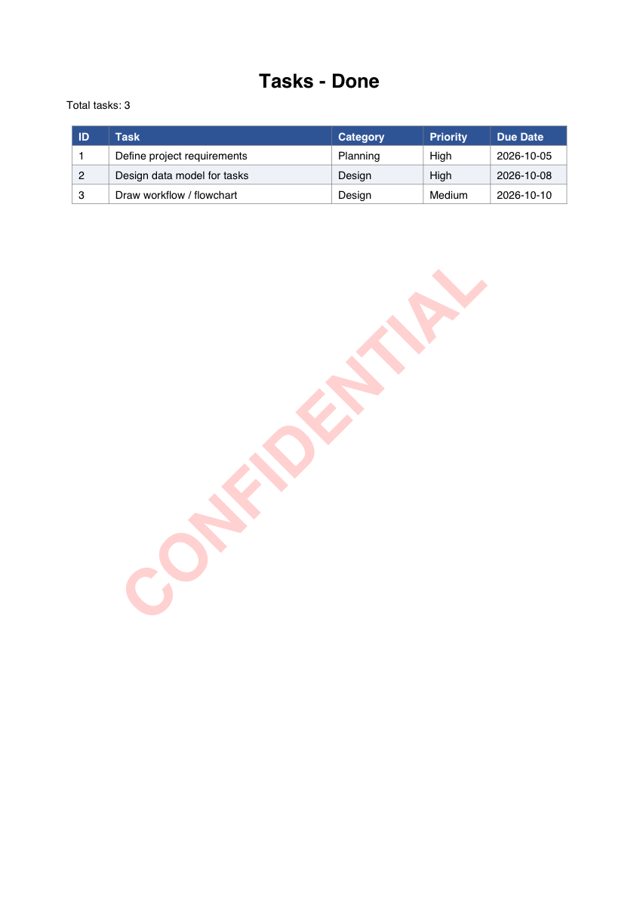

# Week 11: Project Planning & Design — Building an Enhanced Task Manager

**Student ID:** 663380577-8 (Section 2)

โปรเจกต์นี้เป็นเวิร์กโฟลว์ Python ของระบบ **Enhanced Task Manager** โดยอ่านรายการงานจาก `data/tasks.json` แล้วสร้างไฟล์เอาต์พุตอัตโนมัติ 3 ไฟล์ ได้แก่

| ไฟล์ | รายละเอียด |
|------|-----------|
| `output/merged_docs.pdf` | สร้าง PDF แยกตามสถานะงาน (Done / In Progress / To Do) แล้วรวมเป็นไฟล์เดียว |
| `output/generate_report.docx` | รายงาน Word ที่มีสรุปความคืบหน้า ตารางงานทั้งหมด และงานที่ยังค้างเรียงตามวันครบกำหนด |
| `output/watermarked_document.pdf` | `merged_docs.pdf` ที่ใส่ลายน้ำ **CONFIDENTIAL** ไว้ทุกหน้า |

## 🎬 คลิปการสอน / Demo Video

▶️ **[ดูคลิปได้ที่นี่](https://youtu.be/YOUR_VIDEO_LINK)**

## 📁 โครงสร้างโปรเจกต์

```
Week11/
├── src/
│   ├── pdf_processor.py     # สร้าง PDF, รวม PDF, ใส่ลายน้ำ
│   ├── docx_generator.py    # สร้างรายงาน Word
│   └── main.py              # เวิร์กโฟลว์หลัก
├── data/
│   └── tasks.json           # ข้อมูลรายการงาน (input)
├── output/                  # ไฟล์ผลลัพธ์ทั้ง 3 ไฟล์
├── assets/                  # ภาพ screenshot ของผลลัพธ์
│   ├── merged_docs_screenshot.png
│   ├── generate_report_screenshot.png
│   └── watermarked_document_screenshot.png
├── requirements.txt
├── .gitignore
└── README.md
```

## ⚙️ การติดตั้ง

```bash
git clone https://github.com/Sukijtra/663380577-8_Sec2_script_programming.git
cd 663380577-8_Sec2_script_programming/Week11

python3 -m venv venv
source venv/bin/activate        # Windows: venv\Scripts\activate
pip install -r requirements.txt
```

## ▶️ การใช้งาน

```bash
python src/main.py
```

เมื่อรันเสร็จ ไฟล์ทั้ง 3 จะอยู่ในโฟลเดอร์ `output/`

ถ้าต้องการเปลี่ยนรายการงาน ให้แก้ไขไฟล์ `data/tasks.json` แต่ละงานมีฟิลด์ดังนี้

```json
{"id": 1, "title": "Define project requirements", "category": "Planning",
 "priority": "High", "status": "Done", "due_date": "2026-10-05"}
```

ค่า `status` ที่รองรับ: `Done`, `In Progress`, `To Do`

## 🧩 การทำงานของแต่ละโมดูล

- **`pdf_processor.py`**
  - `create_task_pdf()` สร้าง PDF ตารางงานด้วย `reportlab`
  - `merge_pdfs()` รวมไฟล์ PDF หลายไฟล์ด้วย `pypdf.PdfWriter`
  - `add_watermark()` สร้างหน้าลายน้ำเอียง 45° แบบโปร่งแสง แล้ว `merge_page()` ซ้อนทับทุกหน้า
- **`docx_generator.py`**
  - `generate_report()` สร้างเอกสาร Word ด้วย `python-docx` ประกอบด้วยหัวเรื่อง สรุปสถานะ ตาราง และรายการงานค้าง
- **`main.py`**
  - โหลด JSON (มี error handling กรณีไม่พบไฟล์หรือ JSON ผิดรูปแบบ) → สร้าง/รวม PDF → สร้างรายงาน → ใส่ลายน้ำ พร้อม logging ทุกขั้นตอน

## 🖼️ ตัวอย่างผลลัพธ์

### 1. merged_docs.pdf


### 2. generate_report.docx


### 3. watermarked_document.pdf

